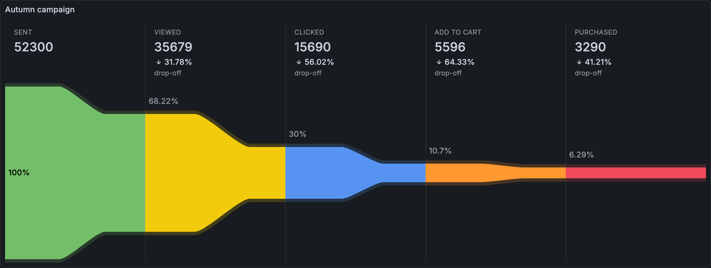

<!-- snippet:use-example-json -->

To use an example, open your dashboard and go to **Dashboard settings** > **JSON Model**. Paste the excerpt into the `panels` array and click **Save changes**.

<!-- /snippet:use-example-json -->

The examples read generated data from the built-in TestData data source. The excerpts leave out the `datasource` property. To run an example unchanged, set the data source of the panel to your TestData data source. To use your own data, replace `targets` with your queries and keep the transformations that your data needs.

## Basic example

A panel excerpt in dashboard JSON has this shape:

```json
{
  "type": "mckn-funnel-panel",
  "title": "Campaign funnel",
  "options": {},
  "fieldConfig": {
    "defaults": {
      "color": { "mode": "palette-classic" },
      "min": 0
    },
    "overrides": []
  },
  "targets": [
    {
      "refId": "A",
      "scenarioId": "csv_content",
      "csvContent": "Label,Value\nSent,52300\nViewed,35679\nClicked,15690\nAdd to cart,5596\nPurchased,3290"
    }
  ],
  "transformations": [{ "id": "rowsToFields", "options": {} }]
}
```

The query returns one row per step. The **Rows to fields** transformation turns the rows into one numeric field per step. With empty `options`, the panel uses the classic layout and sorts the steps from highest to lowest. Each bar shows its percentage of the largest step, and each gap shows the drop from the step above.

## Common variations

### Flow layout from left to right

This variation shows the funnel as one continuous band with the steps from left to right. Each step shows its value and its drop-off from the previous step. Use the data and the transformation of the basic example, and change `options`:

```json
{
  "type": "mckn-funnel-panel",
  "title": "Autumn campaign",
  "options": {
    "layout": "flow",
    "orientation": "horizontal",
    "sorting": "descending",
    "showRemainedPercentage": false
  }
}
```



### Time comparison and data links

This variation compares the funnel with the day before, and links each step to a drill-down dashboard. It needs Grafana 12.3 or later. The **Reduce** transformation gives each step one value per period. `timeCompare` turns on Grafana Time comparison for the panel.

```json
{
  "type": "mckn-funnel-panel",
  "title": "Checkout funnel",
  "timeCompare": "1d",
  "options": {
    "layout": "flow",
    "orientation": "vertical",
    "sorting": "descending",
    "showRemainedPercentage": false,
    "comparisonPeriod": "newest",
    "outcomeDirection": "higher"
  },
  "fieldConfig": {
    "defaults": {
      "color": { "mode": "palette-classic" },
      "min": 0,
      "links": [
        {
          "title": "Drill into ${__field.displayName}",
          "url": "/d/<drill-down-dashboard-uid>?var-step=${__field.displayName:percentencode}&${__url_time_range}"
        }
      ]
    },
    "overrides": [
      {
        "matcher": { "id": "byName", "options": "Added to cart" },
        "properties": [
          {
            "id": "links",
            "value": [
              {
                "title": "Drill into ${__field.displayName}",
                "url": "/d/<drill-down-dashboard-uid>?var-step=${__field.displayName:percentencode}&${__url_time_range}"
              },
              {
                "title": "Open the cart recovery playbook",
                "targetBlank": true,
                "url": "https://example.com/cart-recovery"
              }
            ]
          }
        ]
      }
    ]
  },
  "targets": [
    {
      "refId": "A",
      "scenarioId": "predictable_csv_wave",
      "csvWave": [
        { "name": "Product viewed", "timeStep": 600, "valuesCSV": "1200,1350,1500,1100,1400,1600,1250" },
        { "name": "Added to cart", "timeStep": 600, "valuesCSV": "768,837,975,671,896,1056,775" },
        { "name": "Checkout started", "timeStep": 600, "valuesCSV": "315,326,410,255,358,454,302" },
        { "name": "Payment info", "timeStep": 600, "valuesCSV": "192,189,254,145,215,286,175" },
        { "name": "Order completed", "timeStep": 600, "valuesCSV": "148,142,198,107,163,226,131" }
      ]
    }
  ],
  "transformations": [
    {
      "id": "reduce",
      "options": { "mode": "reduceFields", "reducers": ["sum"], "includeTimeField": false }
    }
  ]
}
```

Replace `<drill-down-dashboard-uid>` with the UID of the dashboard that the links open. The **Added to cart** step gets a second link from the field override. Hover a step and click its menu button to open its links.

### One funnel per platform

This variation repeats a compact funnel for each value of a `platform` dashboard variable, and shows retention instead of drop-off. The dashboard needs a custom variable named `platform` with the values `Web,iOS,Android`, **Include All option** turned on and the custom all value `.*`.

```json
{
  "type": "mckn-funnel-panel",
  "title": "Retention by platform: $platform",
  "repeat": "platform",
  "repeatDirection": "v",
  "options": {
    "layout": "flow",
    "orientation": "horizontal",
    "sorting": "none",
    "showRemainedPercentage": true
  },
  "fieldConfig": {
    "defaults": {
      "color": { "mode": "palette-classic" },
      "min": 0
    },
    "overrides": []
  },
  "targets": [
    {
      "refId": "A",
      "scenarioId": "csv_content",
      "csvContent": "platform,step,users\nWeb,Product viewed,42000\nWeb,Added to cart,19000\nWeb,Checkout started,11500\nWeb,Payment info,8200\nWeb,Order completed,6900\niOS,Product viewed,21000\niOS,Added to cart,11000\niOS,Checkout started,7400\niOS,Payment info,5600\niOS,Order completed,4700\nAndroid,Product viewed,16000\nAndroid,Added to cart,7000\nAndroid,Checkout started,3600\nAndroid,Payment info,2300\nAndroid,Order completed,1600"
    }
  ],
  "transformations": [
    {
      "id": "filterByValue",
      "options": {
        "type": "include",
        "match": "any",
        "filters": [{ "fieldName": "platform", "config": { "id": "regex", "options": { "value": "^${platform}$" } } }]
      }
    },
    {
      "id": "groupBy",
      "options": {
        "fields": {
          "step": { "operation": "groupby", "aggregations": [] },
          "users": { "operation": "aggregate", "aggregations": ["sum"] }
        }
      }
    },
    { "id": "rowsToFields", "options": {} }
  ]
}
```

The **Filter data by values** transformation keeps the rows of one platform. **Group by** sums the users per step, and **Rows to fields** makes one field per step. With `sorting` set to `none`, the steps keep the order of the query.

## Full dashboards

The plugin repository has complete dashboards with these panels and more:

- [Funnel examples](https://github.com/mckn/mckn-funnel-panel/blob/main/provisioning/dashboards/panels.json): the layouts, the sort modes and Time comparison. Some panels use the Static data source plugin.
- [Checkout funnel demo](https://github.com/mckn/mckn-funnel-panel/blob/main/provisioning/dashboards/funnel-demo.json) and its [drill-down dashboard](https://github.com/mckn/mckn-funnel-panel/blob/main/provisioning/dashboards/funnel-demo-drilldown.json): a checkout funnel with Time comparison, a funnel per platform and data links to a drill-down. They use TestData only. The drill-down dashboard filters its data with dashboard variables in transformations, which needs Grafana 11.3 or later.
