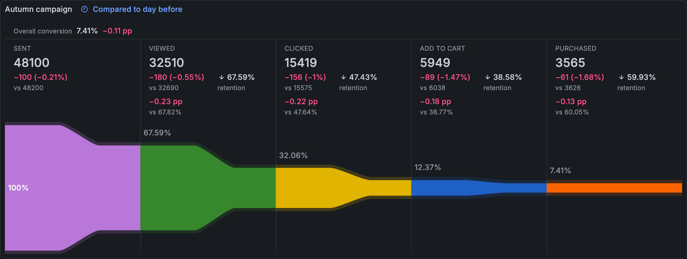

To change these options, edit the panel and use the options pane.

## Panel options

Some options only show for one layout. The **Time comparison** options only show when the panel has a comparison period.

### Funnel

| Option                  | Type   | Default      | Description                                                                                                                                                                                                                   |
| ----------------------- | ------ | ------------ | ----------------------------------------------------------------------------------------------------------------------------------------------------------------------------------------------------------------------------- |
| **Layout**              | Radio  | `Classic`    | Selects how the panel draws the funnel. **Classic**: Centered funnel with labels on the left and percentages on the right. **Flow**: One section per step with details next to a continuous, smoothly narrowing funnel. |
| **Orientation**         | Radio  | `Vertical`   | Selects the direction of the steps. Only shows for the flow layout. **Vertical**: Steps from top to bottom with the funnel on the right. **Horizontal**: Steps from left to right with the funnel below the details.    |
| **Sorting**             | Radio  | `Descending` | Selects the order of the steps, by value. **Descending**: Sort from highest to lowest. **Ascending**: Sort from lowest to highest. **None**: No sorting is applied.                                                  |
| **Show retention rate** | Toggle | `Off`        | Show retention rate instead of drop-off rate in gap labels and tooltips.                                                                                                                                                      |
| **Show percentages**    | Toggle | `On`         | Show the percentage column next to the funnel bars. Only shows for the classic layout.                                                                                                                                        |

With **None**, the steps keep the order of the fields in the query result.

**Show retention rate** also applies to the flow layout. There, each step shows its retention from the previous step instead of its drop-off.

### Time comparison

| Option                     | Type  | Default         | Description                                                                                                                                                                                                       |
| -------------------------- | ----- | --------------- | ----------------------------------------------------------------------------------------------------------------------------------------------------------------------------------------------------------------- |
| **Funnel to display**      | Radio | `Newest period` | Selects the period that the funnel shows. **Newest period**: Show the newest period and its change from the oldest period. **Oldest period**: Show the oldest period and its change from the newest period. |
| **A favorable outcome is** | Radio | `Higher`        | Selects which changes show as favorable. **Higher**: Show increases as favorable. **Lower**: Show decreases as favorable.                                                                                   |

These options only show for the flow layout, when the panel has a Grafana Time comparison period. For how to turn it on, refer to [Time comparison](#time-comparison).

## Standard field options

For what each standard option does, refer to [Configure standard options](https://grafana.com/docs/grafana/latest/panels-visualizations/configure-standard-options/).

The panel turns off **No value** and **Thresholds**. The other standard options stay on, including:

- **Unit**
- **Min**, with a default of `0`
- **Max**
- **Decimals**
- **Display name**
- **Color scheme**, with a default of **Green-Yellow-Red (by value)**
- **Value mappings**
- **Data links**

Keep **Min** at `0`. The panel draws each step relative to the field range, so a different minimum changes the widths and the percentages. For more information, refer to [Troubleshooting](./troubleshooting.md#the-percentages-look-wrong).

## Time comparison

The flow layout can compare the funnel with an earlier period. It shows one funnel at a time, and each step shows its change from the other period:

- The count change, for example `+1200 (+3.5%)`, and the count of the other period.
- The change of the drop-off or retention rate in percentage points, for example `+2.1 pp`, and the rate of the other period.
- A header with the overall conversion from the first to the last step, and its change.

To compare, edit the panel and turn on **Time comparison** in the time settings of the panel. Grafana adds a second period to the query results, and the panel compares the two periods. To go back to a single funnel, turn off **Time comparison**.

- Time comparison needs Grafana 12.3 or later. Grafana 12.3 also needs the `panelTimeSettings` and `timeComparison` feature toggles.
- Only the flow layout compares. The classic layout shows the current period only.
- Each step of each period must have exactly one value. For how to shape the data, refer to [Data formats](./data-formats.md#time-comparison).

Grafana shows the compared period next to the panel title, for example **Compared to day before**. A change shows as `—` when the panel can't calculate it, for example when the count of the other period is zero.

The **A favorable outcome is** option sets the colors of the changes. With **Higher**, increases are green and decreases are red. With **Lower**, the colors are the other way around. A higher retention rate counts as a higher outcome, and a higher drop-off rate as a lower outcome.

The steps are sorted by the period that the funnel shows, and the step names come from the newest period.

> [!NOTE]
> A plain **Time shift** changes the time range of the whole panel. It doesn't add a second period to compare with.

## Data links

Add links with the standard **Data links** field option to link each step to another dashboard or page.

In the flow layout, hover or focus a step to show a menu button with three vertical dots in its corner. The button is labeled **Data links for** and the step name. Click it to open a menu with the data links of that step. The classic layout doesn't show data links.

To give one step other links, add a field override for that step. For an example, refer to [Examples](./examples.md#time-comparison-and-data-links).

## Tooltips and highlights

In the classic layout, hover a bar to see the step name, its value and its percentage. Hover the gap between two bars to see the drop from one step to the next, for example `31.78% drop from "Sent" to "Viewed"`. With **Show retention rate**, the gap shows the retained percentage instead.

The flow layout has no tooltips. Hover a step to highlight it in the details and in the band.
